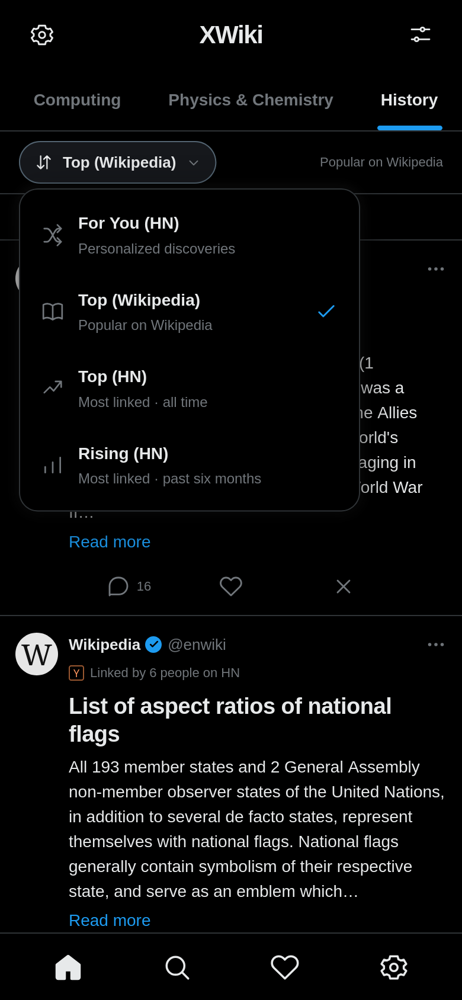

<p align="center">
  
</p>

# xWiki

**A Wikipedia rabbit hole, one post at a time.**

xWiki turns Wikipedia articles shared on Hacker News into a personal, X-style feed. Explore more than 200,000 articles, follow your favorite subjects, and jump into the discussions that made people share them.

**[Try the app →](https://mdel2424.github.io/XWiki/)** · [Run locally](#run-locally) · [Development guide](docs/development.md)

## Take a look

<table>
  <tr>
    <th>Home</th>
    <th>Sort any topic</th>
    <th>Search</th>
  </tr>
  <tr>
    <td></td>
    <td></td>
    <td></td>
  </tr>
</table>

## Follow your curiosity

- **A feed that learns your interests.** Home’s For You sort mixes discoveries, popular articles, and rising topics. Heart a post to see more related ideas; mark it as seen to hide it, or choose Not interested to steer recommendations away from it.
- **Your subjects, your timeline.** Open any topic or pin favorites beside Home. The picker starts alphabetically; drag its handles to set your own order, including your pinned tabs. Computing, Physics & Chemistry, and History start pinned; your choices stay saved in your browser.
- **Choose how you explore.** Beneath the topic tabs, sort by For You (HN), Top (HN), Rising (HN), or Top (Wikipedia). Every option stays within your selected subject.
- **Read a little. Explore further.** Previews use the lead image or the first suitable image in the article where available. Expand a preview to its full first paragraph, or open the article on Wikipedia when something catches your attention.
- **See why it was shared.** The comments button opens the original Hacker News mentions, with links back to their discussions.
- **Find your next rabbit hole.** Search across the archive, then return to the same topic and sort on Home.

Explore **21 subjects**, including Places, Computing, History, Mathematics, Philosophy & Religion, Biology & Medicine, and Internet Culture. Topics use [Wikipedia’s own article-topic predictions](https://wikitech.wikimedia.org/wiki/Search/articletopic), so a history article can belong in History without having “history” in its title. Each list starts with the personalized discovery feed and supports all four sorts.

No account needed. Likes, seen posts, and pinned topics stay in this browser. The dark interface works on phones and desktop, with pull-to-refresh on Home and keyboard navigation for the feed tabs.

## Run locally

With Node.js 22 or later, from the project directory:

```sh
npm start
```

Open [localhost:4173](http://localhost:4173/). The repository includes the article catalogue, so browsing locally needs no database setup.

## Under the hood

The app is plain HTML, CSS, and JavaScript backed by a prebuilt JSON catalogue. Recommendations run in the browser; the deployed site needs only static hosting. Wikipedia images and fresh first paragraphs can load from Wikimedia.

Python and SQLite are used separately to prepare the archive. For building, testing, deployment, and data updates, see the [development guide](docs/development.md) and [data pipeline notes](docs/pipeline.md).

## Sources & credits

Articles are discovered through the [Open Index Hacker News archive](https://huggingface.co/datasets/open-index/hacker-news), supplemented by the [official Hacker News API](https://github.com/HackerNews/API), with article content from Wikipedia.

Wikipedia text is CC BY-SA; article histories and image pages provide attribution and image-specific licenses. xWiki is independent of X, Wikipedia, Hacker News, and the original WikiHack.
