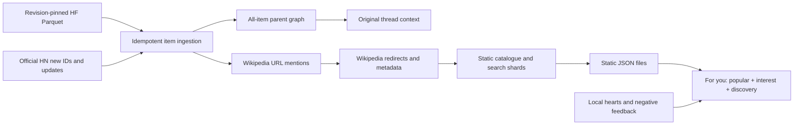

# Archive choice and pipeline

## Sources evaluated

| Source | Role / decision |
| --- | --- |
| [Open Index on Hugging Face](https://huggingface.co/datasets/open-index/hacker-news) | Primary bulk archive. Documents historical backfill and frequent Firebase live blocks. Monthly `data/YYYY/YYYY-MM.parquet` plus `today/YYYY/MM/DD/HH/MM.parquet`; no user Google project needed. |
| [Official HN API](https://github.com/HackerNews/API) | Authoritative per-item fetches for new IDs, changes, retry IDs and gap verification. |
| [BigQuery public datasets](https://docs.cloud.google.com/bigquery/public-data) | Alternative bulk source. Queries execute under the querying project and can incur query charges. No queries were started against the supplied Google project. |
| [ClickHouse sample](https://clickhouse.com/docs/get-started/sample-datasets/hacker-news) | The tutorial describes an older 28-million-row snapshot. That static file was not chosen for current coverage. |
| [ClickHouse history/playground](https://github.com/ClickHouse/ClickHouse/issues/29693) | Different from the tutorial snapshot, with historical updates/versions. Its current max timestamp was not independently measured here. Versioned data must be collapsed to each item’s latest version before Wikipedia filtering. |

This choice is based on the source structure and access model, not a verified assertion that any mirror is the freshest today. Retrieved archive documentation was cached. Runtime imports record the actual repository revision, source update timestamp, newest record timestamp, imported shard count and HN cursor. See [monthly statistics](https://huggingface.co/datasets/open-index/hacker-news/blob/main/stats.csv) and [live-block statistics](https://huggingface.co/datasets/open-index/hacker-news/blob/main/stats_today.csv) for the provider’s manifests.

## Flow

Raw HF numeric types are mapped to HN story/comment/poll/pollopt/job names. Timestamps are normalized to UTC. HTTP retries are bounded; batch writes and shard row offsets share a SQLite transaction. Full text is retained only for Wikipedia-bearing records, while all IDs, immediate parents and story titles are retained for thread resolution. SQLite is used only during data preparation. The published website retrieves versioned JSON files and runs no database or application API.

URL processing covers HTTP/HTTPS, mobile hosts, language preservation, URL-encoded titles, anchors, `w/index.php?title=…`, and known non-article namespaces. Wikimedia redirects produce canonical article IDs and aliases. Languages remain separate. Shortlink domains and mentions without a Wikipedia URL are not expanded.

## Ranking

Top counts distinct non-deleted authors per canonical article. Multiple links from one HN item/article pair count once; multiple posts by the same author do not increase distinct-linker count. Rising uses the same principle over the last six calendar months, as of the latest statistics rebuild. Full mention totals remain independent from the separate paginated comment files.

For you retrieves separate random, Rising and Top candidate pools. Eight posts in each ten-post block come from archive-wide random draws, one from Rising and one from Top. Featured picks are shuffled from the leading 1,000 positions in their respective ranking; the dedicated tabs remain ordered by rank. Each source has its own permutation cursor. Draws refill around posts already loaded, rejected or seen, preventing cross-page duplicates and source overlap. When an eligible source is exhausted, remaining discoveries fill its slots.

A local TF-IDF cosine model boosts discovery order using liked titles, descriptions, summaries, Wikipedia categories and outgoing links; negative feedback applies a stronger penalty. Hearts do not reorder Top or Rising. Seen signals stay separate from topic preferences. Each heart is a binary signal; unlike removes it. There is no cross-user collaborative model.

`npm run data:rank` can regenerate a six-month Rising index directly from the exported original comments, without importing the HN database again. It counts distinct non-deleted authors and mentions in the inclusive window, excluding future timestamps, then publishes an immutable index and atomically switches `risingPath` in the manifest. Original cards, all-time order and context blocks stay intact. Card `recent*` metrics from an older full export are not used to order the static tabs; the updated rank index is authoritative. Full exports produce the same six-month window.

The global archive makes all-time candidates possible; before import the UI labels its preview collection. Content similarity can only be as good as the available Wikipedia metadata. On-demand browser metadata improves the current pool; `data:enrich` persists metadata for subsequent retrieval. Feedback is language-specific and does not perform cross-language semantic translation.

## Coverage and reconciliation

- “All manifest shards imported” is **not** equivalent to every historical HN ID being present. `data:audit` scans actual IDs and records internal gaps.
- `data:fill-gaps` verifies bounded intervals through the official API and advances a separate traversal cursor. A successful null response remains a retry/gap record, not an invented item or a false completeness claim.
- `maxitem` discovers new IDs. `updates` revisits changed older IDs; an overlap window and durable retries supplement it. Updates are not a durable historical change log. Keep periodic archive reconciliation and gap checks.
- Existing HF nodes and mentions are upserted when changed shards are reimported. A provider snapshot without reliable per-record version timestamps cannot prove the newest edit for every overlapping record. Official updates help reconcile this; deletions take effect when observed. An archive row disappearing without a deletion record cannot itself prove deletion.
- An interruption leaves committed batches intact and keeps snapshot completion false. Re-running `data:sync` discovers a pinned manifest and resumes unchanged partial shard offsets.
- Statistics and FTS are rebuilt after a successful CLI operation. While a long backfill is running, the published site continues to serve its existing exported generation. Rising’s six-month cutoff is refreshed by `data:tail`, `data:watch` or another rebuild, and becomes visible after a new static export is published.

The implementation was exercised with deterministic local fixtures, including interruption, duplicates, edits/deletions and nested replies. Live HF/Firebase connectivity, actual full-volume throughput and remote Parquet execution remain unverified because the creation environment blocks outbound DNS/network access.

## Static publication

`pipeline/static_export.py` exports all articles and original linked comments from a consistent database snapshot. Cards, search postings, rank orders, ID aliases and comment blocks are split into lazily fetched files. Context offsets are checked against full mention totals. A generation identifier prevents mixing resource paths from different snapshots. The browser client in `src/static-catalog.js` handles candidate retrieval, prefix search and context pagination without `/api` endpoints. The full current site is approximately 613 MB; the build rejects output above 950 MB.
